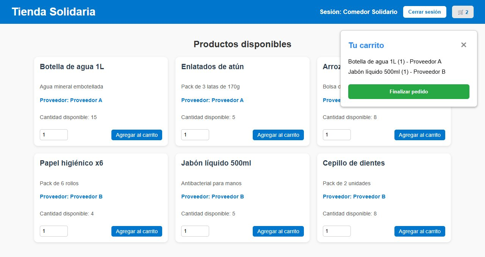
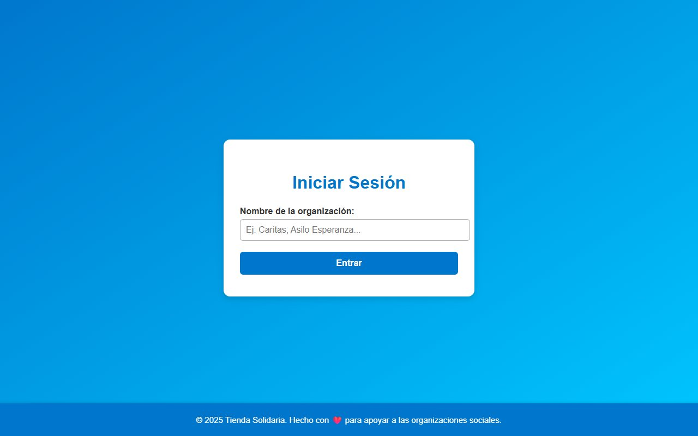

# Tienda Solidaria

Proyecto final del curso de Sistemas Distribuidos de la UNSA (julio de 2025). Una organización social entra con su nombre, ve los productos de dos proveedores y arma un pedido. Cada proveedor es un nodo independiente, con su propia API y su propia base de datos, y el frontend habla con los dos a la vez.



## Cómo funciona

- `nodo_1` (puerto 8000) y `nodo_2` (puerto 8001) son la misma API en FastAPI, cada una con su SQLite (`nodo1.db` y `nodo2.db`). El código compartido está en `shared/`.
- Al arrancar, cada nodo carga su inventario desde su `inventario.json`. Cuando atiende un pedido, descuenta el stock en la base y vuelve a escribir el JSON.
- Si se pide más de lo que hay, el nodo responde con error y no toca el stock.
- El frontend consulta `/inventario/` en los dos nodos, muestra de qué proveedor es cada producto y, al finalizar, envía cada ítem del carrito a `/pedido/` en su nodo.

El carrito se guarda en `localStorage`, así que no se pierde al recargar la página.

## Ejecutarlo

```
python -m venv venv
venv\Scripts\activate
pip install -r requirements.txt
iniciar.bat
```

`iniciar.bat` abre los dos nodos con uvicorn, sirve el frontend en el puerto 8080 y abre el navegador. Para entrar basta con escribir el nombre de la organización.



## Estructura

```
nodo_1/, nodo_2/   API de cada proveedor e inventario inicial en JSON
shared/            modelo Producto y conexión a SQLite (SQLAlchemy)
frontend/          login, tienda, carrito y confirmación (HTML, CSS y JavaScript)
iniciar.bat        levanta todo en Windows
```

© 2025 José Luis Cuenca Gutiérrez. Todos los derechos reservados.
